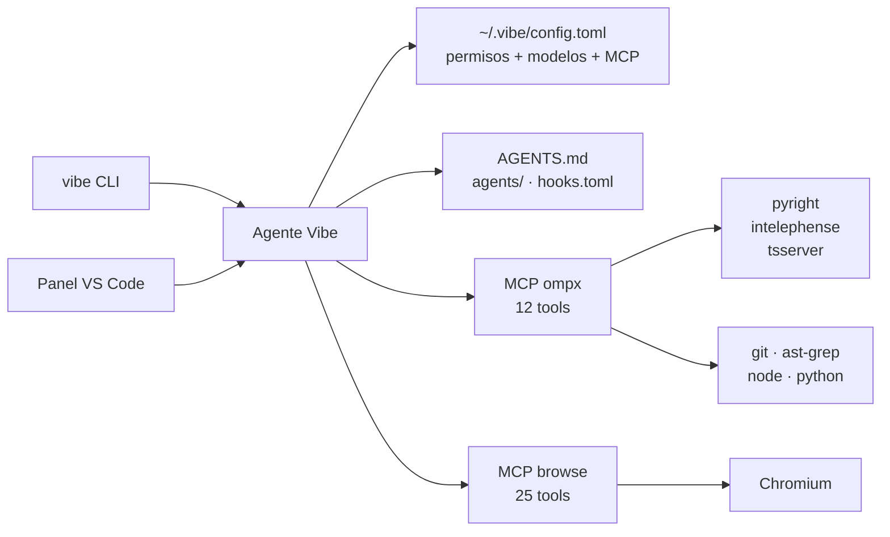

<p align="center">
  
  
  
  
</p>

<p align="center">
  
  
  
  
</p>

<h1 align="center">MCPMistralOMP</h1>

<p align="center">
  <b>Mistral Vibe</b> configurado para trabajar como omp: autonomía con frenos, herramientas que Vibe no trae,<br>
  navegador real y una política de shell que no depende de que el modelo obedezca.
</p>

---

## Qué obtienes

| | |
|---|---|
| **12 tools MCP propias** | búsqueda, lectura de documentos, LSP, ejecución con estado, ast-grep, parches, historial |
| **Navegador real** | 25 tools de Playwright: navegar, capturas, formularios, consola, red |
| **LSP de verdad** | pyright (Python), intelephense (PHP), typescript-language-server (TS/JS) |
| **Agentes** | `plan` (solo lectura), `scout`, `reviewer`, `ui-designer` |
| **Política** | denylist, archivos sensibles, hook que bloquea `cat`/`sed -i`/`echo >` |
| **Reproducible** | un instalador idempotente que reescribe rutas y comandos según la plataforma |

## Cómo funciona



## Instalación

**Windows**

```powershell
git clone https://github.com/alexandervi1/MCPMistralOMP.git $env:USERPROFILE\.vibe-omp
powershell -ExecutionPolicy Bypass -File $env:USERPROFILE\.vibe-omp\install.ps1
```

**macOS / Linux**

```bash
git clone https://github.com/alexandervi1/MCPMistralOMP.git ~/.vibe-omp
bash ~/.vibe-omp/install.sh
```

Otros workspaces (el trust es por prefijo de ruta):

```bash
bash install.sh ~/dev /mnt/work
# o en Windows:
# powershell -File install.ps1 -TrustRoots "C:\dev","D:\work"
```

En VS Code: `/reload` o **Developer: Reload Window**.

## Requisitos

| Pieza | Versión | Por qué |
|---|---|---|
| Mistral Vibe | 3.1.4+ | CLI; la extensión de VS Code trae su propio agente |
| Python | 3.11+ | el MCP es stdlib; `pypdf` opcional para PDFs |
| Node | 18+ | kernels JS, language servers y ast-grep |
| Git | cualquiera | `.gitignore` exacto y `apply_patch` |
| PowerShell · Bash | — | instalador de cada plataforma |

## Las 12 tools de `ompx`

| Tool | Qué hace |
|---|---|
| `glob` | rutas por patrón con `.gitignore` exacto (`git ls-files`) |
| `grep` | `ruta:línea: texto`, contexto, paginación, filtro por glob |
| `read` | rangos; URL, PDF, docx/pptx/xlsx, zip; bloquea `.env`, `secrets/`, `*.pem`, `*.key`, `.ssh` |
| `apply_patch` | diff unificado con `git apply`; por defecto solo `--check` |
| `ast_grep` | búsqueda estructural (`$A`, `$$$`) |
| `ast_replace` | reescritura estructural; `apply=true` escribe |
| `lsp_query` | definiciones, referencias, hover, diagnósticos, símbolos, `rename`, `format`, `code_actions`, símbolos de workspace |
| `eval_python` | kernel persistente: variables e imports sobreviven |
| `eval_js` | kernel Node persistente (`var`/`globalThis`, `await`) |
| `sessions` | busca en el historial |
| `sessions_get` | reconstruye una sesión por id |
| `ompx_info` | versión, rutas, language servers, catálogo |

### Navegador (`browse`)

Navegar, snapshot de accesibilidad, captura, click, escritura, formularios, hover, select, drag/drop, teclas, pestañas, resize, consola, red, emular media, diálogos y `evaluate`.

## Agentes y skills

| Agente | Para qué |
|---|---|
| `plan` | explorar y proponer sin tocar archivos |
| `scout` | subagente de exploración en solo lectura |
| `reviewer` | hallazgos con `archivo:línea`, sin arreglar |
| `ui-designer` | carga `impeccable` y verifica con capturas |

Se suman **13 skills de superpowers** (debugging sistemático, TDD, planes, review, worktrees) enlazadas desde `~/.omp`, y las **49 propias** que ya vivían en `~/.agents/skills`.

## Qué hace el instalador

1. Crea `~/.vibe/{agents,hooks,mcp/ompx}`.
2. Copia la config, respalda la anterior en `config.toml.prev` y **reescribe rutas y comandos** (`python`/`py`/`python3`, `npx` vs `cmd /c npx`).
3. Añade los roots a `trusted_folders.toml` sin duplicar.
4. `npm install` con versiones fijadas: pyright, intelephense, TypeScript 5, tsserver, ast-grep.
5. Enlaza las skills de `superpowers` e invalida la caché de catálogo MCP de Vibe.

## Verificación

```bash
vibe --version
vibe -p "Responde exactamente: OK" --max-turns 1
vibe -p "Lista las tools del servidor ompx, una por linea"
```

En el panel: modelo **DeepSeek V4.1 Flash**, agentes `plan` y `ui-designer`, thinking `none/low/high/xhigh/max`.

## Estructura

```
.
├── install.ps1              Windows: 5 pasos idempotentes
├── install.sh               macOS/Linux: equivalente con symlinks
├── vibe/
│   ├── config.toml          permisos, denylist, MCP, modelos
│   ├── AGENTS.md            reglas, mapa de tools, traducción de skills
│   ├── hooks.toml + hooks/  interceptor de shell
│   └── agents/              plan · scout · reviewer · ui-designer
├── mcp/ompx/
│   ├── server.py            12 tools, JSON-RPC a mano, sin deps Python
│   ├── lsp_client.py        cliente LSP con reintentos y detección de muerte
│   └── package.json         deps fijadas
└── scripts/
    ├── port_config.py       rutas y comandos por plataforma
    └── merge_trust.py       trust idempotente
```

## Mantenimiento

<details>
<summary><b>Tras cambiar las tools de un MCP</b></summary>

Vibe cachea el catálogo por servidor:

```bash
rm -f ~/.vibe/logs/mcp-descriptors/unified/*.json
```
</details>

<details>
<summary><b>Depurar LSP o el MCP</b></summary>

```bash
touch ~/.vibe/mcp/ompx/trace
# usa la tool, luego:
less ~/.vibe/mcp/ompx/ompx-trace.log
```
</details>

<details>
<summary><b>Los cambios hechos con <code>/config</code> no llegan al repo</b></summary>

`/config` y `/skills` escriben en `~/.vibe/`. Para que sobrevivan a una reinstalación:

```bash
cp ~/.vibe/config.toml vibe/config.toml   # desde la raíz del repo
```
</details>

## Mapa con omp

| En omp | Aquí |
|---|---|
| tools `grep`/`glob`/`read`/`eval`/`lsp`/`ast_edit` | MCP **ompx** |
| navegador | MCP **browse** |
| `AGENTS.md` global | `vibe/AGENTS.md` |
| `agents/*.md` | `vibe/agents/*.toml` |
| `bashInterceptor` | `vibe/hooks/intercept.py` |
| hooks `.ts` | shell + JSON por stdin |
| subagentes con MCP | no posible (regla de Vibe) |

## Límites conocidos

- **Subagentes sin MCP**: `scout` y `reviewer` solo ven `read_file`, `bash` y `skill`.
- **Panel sin `smart-approve`**: la extensión embebida es 3.1.3; el CLI sí lo tiene.
- **Sin roles `smol`/`tiny`**: el provider solo sirve 3 modelos.
- **Office sin formato**: docx/pptx/xlsx devuelven texto (xlsx solo valores, sin fórmulas).
- **`apply_patch`** requiere git y no aplica parches binarios.
- **macOS/Linux**: instaladores listos, ejecutados solo en Windows hasta ahora.

## Seguridad

`default_agent = "accept-edits"` y `bash` en `permission = "always"`: el agente ejecuta shell sin preguntar. La denylist cubre `rm -rf`, `git reset --hard`, `git push --force` y publishes; `sensitive_patterns` frena `rm`, `mv`, `chmod`, `curl`, `ssh`, `reg`. Fuera del workdir siempre pregunta.

En repos ajenos: `vibe --agent ask` o `vibe --agent plan`.

---

<p align="center">
  <sub>MIT · hecho para que el agente trabaje, no para que lo vigiles</sub>
</p>
